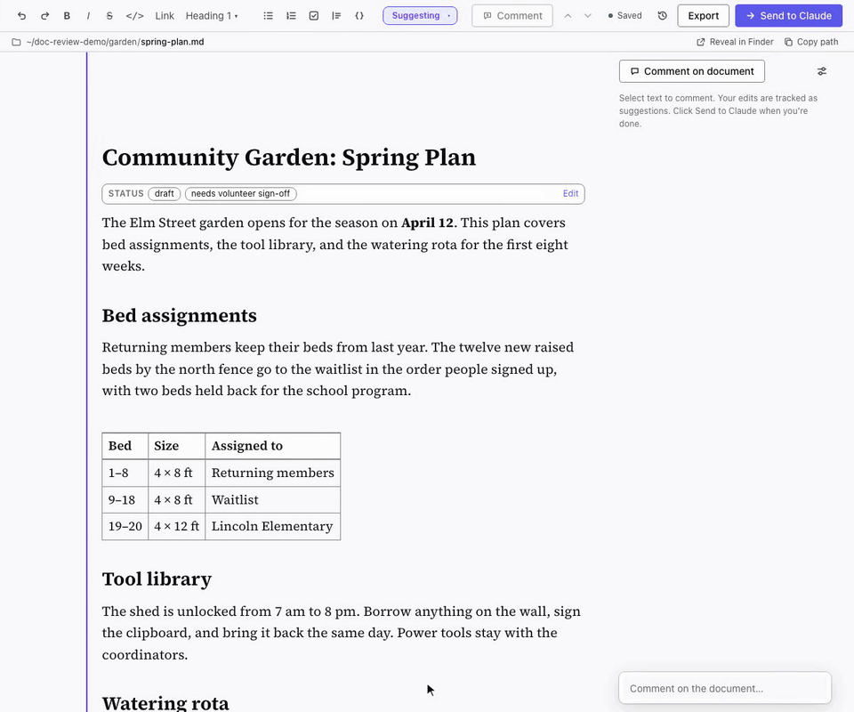

# doc-review

Mark up a Markdown file with Claude the way you would a Google Doc.



`doc-review` opens a `.md` file as a page beside your Claude Code chat. You highlight text and leave margin comments,
type in **Suggesting** mode so every change is tracked, and accept or reject Claude's suggested edits one card at a
time. When you finish a pass you click **Send to Claude**, and the session wakes up, reads only what changed, and
answers in the margin. The file on disk stays plain Markdown, byte for byte, except where you or Claude edit it.

## What's in the box

- **A local web editor** (React, [Milkdown](https://milkdown.dev) on ProseMirror,
  [prosemirror-suggest-changes](https://www.npmjs.com/package/@handlewithcare/prosemirror-suggest-changes)) with
  margin threads, suggestions, version history, tables, frontmatter and a status-line chip.
- **A small server** ([Hono](https://hono.dev)) bound to `127.0.0.1` only. One server per folder, idle-stops after
  four hours.
- **`mdr`, a CLI for agents.** Every command prints one JSON document and exits with a meaningful code, so Claude can
  comment, suggest, edit and resolve threads without touching the editor.
- **A review log next to the file** (`<name>.md.review.jsonl` plus a `.review/` folder). Comments, suggestions and
  history live there, so nothing is lost when no one has the page open.
- **Google Docs and Word bridges.** Import a Google Doc with its comments, or export a review to a new Google Doc or a
  `.docx` with the comments anchored on the right words.
- **A Claude Code plugin and skill** that teach Claude the review loop: open, mark up, wait for Send, read what's
  pending, answer, repeat.

Third-party documents (an agency draft, a vendor contract) open **suggest-only**: Claude can comment and suggest but
every direct edit is refused until you lift it.

## Requirements

- Node.js 22.22+, 24.15+ or 26+
- macOS or Linux (Windows works through the plugin; it is less tested)
- [Claude Code](https://docs.claude.com/en/docs/claude-code) for the agent loop. The desktop app's Browser pane is the
  nicest place to view the page; any browser works.

## Install

### As a Claude Code plugin (easiest)

In a Claude Code session:

```
/plugin marketplace add teeejlind/doc-review
/plugin install doc-review@doc-review
```

Start a new session, then ask in your own words: "Open `launch-plan.md` so I can comment on it." The first run
downloads a pinned Node.js build from nodejs.org (checked against SHA-256 hashes in
`plugins/doc-review/scripts/runtime.lock`) into the plugin's own data folder. Nothing else on your machine changes.
More in [`plugins/doc-review/README.md`](plugins/doc-review/README.md).

### From source

```bash
git clone https://github.com/teeejlind/doc-review.git
cd doc-review
npm ci
npm run build
npm link        # puts `mdr` on your PATH
```

Then install the skill so Claude knows the loop: copy `integrations/skill/` to `~/.claude/skills/doc-review/`, and
optionally paste [`integrations/claude-md-snippet.md`](integrations/claude-md-snippet.md) into your project's
`CLAUDE.md`.

## CLI usage

```bash
# Serve a document and print its URL plus the waiter command for the agent
mdr open ~/notes/garden/spring-plan.md

# What the agent sees: block refs and the current revision
mdr snapshot ~/notes/garden/spring-plan.md --md

# Leave a comment and a tracked suggestion
mdr comment ~/notes/garden/spring-plan.md --quote "two beds held back" --body "Has the school confirmed?"
mdr suggest ~/notes/garden/spring-plan.md --quote "whoever is around" \
  --replace "sign up on the group chat by Friday" --reason "Clearer ownership."

# Several ops in one round
mdr batch ~/notes/garden/spring-plan.md --ops-file round.json

# After the user clicks Send to Claude: what changed since the last round
mdr pending ~/notes/garden/spring-plan.md

# Someone else's document: comments and suggestions only
mdr open ~/inbox/agency-release.md --suggest-only

# Housekeeping
mdr status ~/notes/garden/spring-plan.md
mdr doctor
mdr stop ~/notes/garden
```

The full command list, result shapes and exit codes are in
[`integrations/skill/references/cli.md`](integrations/skill/references/cli.md); every batch op has an example in
[`batch-ops.md`](integrations/skill/references/batch-ops.md).

### Configuration

| Setting | How | Default |
|---|---|---|
| Your name on comments | `mdr config set name "Ana Díaz"` or `MDR_USER_NAME` | git `user.name`, then the OS account name |
| Folders the server refuses to serve | `mdr config set protected "approvals,legal/signed"` or `MDR_PROTECTED_SEGMENTS` | nothing beyond `/` and `$HOME` |

`mdr config get` prints what is in effect and where it came from.

## How the loop works

1. Claude runs `mdr open` and points the Browser pane at the printed `http://127.0.0.1:<port>/?file=<rel>` URL.
2. Claude starts the printed `waiter.command` as a background shell task and ends its turn.
3. You comment, edit, accept and reject. The page autosaves; nothing reaches Claude yet.
4. You click **Send to Claude**. The waiter exits, the session wakes, and Claude runs `mdr pending` to read only your
   new comments, edits and decisions.
5. Claude answers with one `mdr batch` and starts the waiter again. Repeat until you say done.

If no waiter is running, Send copies a prompt to paste into the chat instead.

## Development

```bash
npm run dev          # server on :8299 plus Vite, serving tests/fixtures/docs
npm run typecheck
npm run lint
npm test             # Vitest: unit and contract tests
npm run e2e          # Playwright: builds to .e2e-dist/ and drives Chromium
npm run corpus       # round-trip fidelity over the synthetic corpus
npm run build:plugin # regenerates plugins/doc-review/runtime/
```

`CONTRACTS.md` is the design spec the code was built against: the sidecar log format, the HTTP API, the CLI's JSON
results and the editor bridge. Several tests read its JSON examples directly, so it stays in sync with the code.

`npm run corpus` can also run over your own Markdown: `MDR_CORPUS_WORKSPACE=~/notes python3 scripts/build-corpus.py`
copies it into the gitignored `tests/corpus/fixtures/real/`.

## Layout

```
cli/            mdr commands and argument parsing
core/           Markdown model, splice (byte-exact saves), anchors, suggestions, the review log
node/           doc store, locking, config, identity, protected roots
server/         Hono routes, SSE, the Send to Claude handoff
shared/         types, zod schemas, constants shared by every layer
web/            the editor UI
integrations/   the Claude skill and a CLAUDE.md snippet
plugins/        the Claude Code plugin (skill, Node bootstrap scripts, built runtime)
tests/          unit, contract, e2e and corpus tests
```

## License

[MIT](LICENSE). Bundled third-party licenses for the plugin runtime are listed in
[`plugins/doc-review/runtime/THIRD_PARTY_LICENSES.txt`](plugins/doc-review/runtime/THIRD_PARTY_LICENSES.txt).
